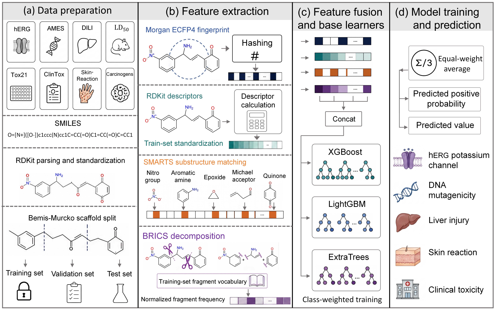

# ToxSAIL

**ToxSAIL: A Structural Alert and Fragment-Guided Hybrid Framework for Drug Toxicity Prediction**

This repository contains the experiment code for ToxSAIL, a toxicity-focused molecular prediction workflow. The final model uses SMILES-derived structural features and a fixed late-ensemble predictor rather than a neural sequence model.

## Framework Overview



**Figure 1. Overview of the ToxSAIL framework.**
(a) *Data preparation*: eight public toxicity endpoints (hERG, AMES, DILI, LD50, Tox21, ClinTox, Skin-Reaction, Carcinogens) are parsed and standardized from SMILES with RDKit, then divided into training, validation, and test sets by Bemis-Murcko scaffold split.
(b) *Feature extraction*: each molecule is encoded as Morgan ECFP4 fingerprints, RDKit physicochemical descriptors standardized with training-set statistics, curated toxic-alert SMARTS indicators (nitro group, aromatic amine, epoxide, Michael acceptor, quinone, and others), and normalized BRICS fragment frequencies over a training-set fragment vocabulary.
(c) *Feature fusion and base learners*: the four feature blocks are concatenated into a single representation used to train XGBoost, LightGBM, and ExtraTrees base learners with class-weighted training.
(d) *Model training and prediction*: the three base learners are combined by an equal-weight late ensemble that outputs a predicted positive probability for classification endpoints or a predicted value for LD50 regression.

## Method Overview

For each molecule, the pipeline builds four feature blocks:

```text
SMILES
  -> Morgan ECFP fingerprints
  -> RDKit physicochemical descriptors
  -> curated toxic-alert SMARTS indicators
  -> BRICS/GPS fragment, fragment-alert, and interaction features
```

The default feature set is `ecfp_desc_alerts_gps`. Base predictors are XGBoost, LightGBM, and ExtraTrees. The reported `toxsail` model is the mean late ensemble of these three base predictors.

Classification tasks report ROC-AUC and PR-AUC. Multi-label tasks such as Tox21 keep missing labels as missing and mask them during metric calculation. The LD50 regression task uses train-set target normalization during fitting and reports MAE, RMSE, and Spearman correlation after inverse transformation to the original scale.

## Repository Contents

```text
.
├── hybrid_benchmark.py       # main experiment entry point
├── configs/
│   └── toxsail.json          # default experiment configuration
├── data/
│   ├── README.md             # data-source notes
│   └── *.tab                 # cached public toxicity benchmark tables
├── docs/
│   └── toxsail_framework.png # framework overview figure
├── src/
│   ├── baselines.py          # tree/boosting base predictors
│   ├── hybrid_benchmark.py   # benchmark runner
│   ├── metrics.py            # classification/regression metrics
│   ├── data/                 # TDC/local loading and scaffold split
│   └── features/             # ECFP, descriptors, alerts, BRICS/GPS features
├── scripts/
│   ├── submission_supplementary_experiments.py
│   ├── summarize_feature_ablation.py
│   └── summarize_submission_supplement.py
├── tests/
│   └── test_gps_no_leakage.py
├── requirements.txt
└── README.md
```

Generated outputs are intentionally not part of the clean GitHub package. Running the scripts will create `results/` and `tables/` locally.

## Data Sources

The toxicity tasks are public benchmark datasets commonly available through TDC/MoleculeNet-style toxicity benchmarks:

- `hERG` from the TDC Tox benchmark.
- `AMES` from the TDC Tox benchmark.
- `DILI` from the TDC Tox benchmark.
- `LD50` / `LD50_Zhu` from the TDC Tox benchmark.
- `Tox21` multi-label toxicity benchmark.
- `ClinTox` clinical toxicity benchmark.
- `Skin-Reaction` from the TDC Tox benchmark.
- `Carcinogens` / `Carcinogens_Lagunin` from the TDC Tox benchmark.

The repository package includes small cached `.tab` files under `data/` so that experiments can run without network access. If these files are removed, the loader will try PyTDC for supported dataset names.

## Installation

Create a fresh environment and install the dependencies:

```bash
pip install -r requirements.txt
```

If `rdkit` installation fails through pip, use conda-forge:

```bash
conda install -c conda-forge rdkit
pip install -r requirements.txt
```

## Quick Smoke Test

Run one dataset and one seed:

```bash
python hybrid_benchmark.py \
  --datasets AMES \
  --models xgb lgbm extra_trees toxsail \
  --split scaffold \
  --seeds 42 \
  --feature-set ecfp_desc_alerts_gps \
  --data-dir data \
  --n-estimators 100 \
  --n-jobs 4
```

## Main Toxicity Benchmark

Run the full ToxSAIL experiment:

```bash
python hybrid_benchmark.py \
  --datasets hERG AMES DILI LD50 Tox21 ClinTox Skin-Reaction Carcinogens \
  --models xgb lgbm extra_trees toxsail \
  --split scaffold \
  --seeds 42 43 44 45 46 \
  --feature-set ecfp_desc_alerts_gps \
  --alert-set expanded \
  --fragment-vocab-size 256 \
  --min-fragment-count 2 \
  --n-estimators 600 \
  --n-jobs 16 \
  --data-dir data \
  --continue-on-error
```

Main outputs:

- `results/hybrid_benchmark/<timestamp>_hybrid_benchmark/metrics.csv`
- `results/hybrid_benchmark/<timestamp>_hybrid_benchmark/per_task_metrics.csv`
- `results/hybrid_benchmark/<timestamp>_hybrid_benchmark/metrics_summary.csv`
- `tables/toxicity_hybrid_benchmark.csv`

## Feature Ablation

Run the feature-level ablation with the same split and seeds:

```bash
for fs in ecfp desc alerts ecfp_desc ecfp_alerts ecfp_desc_alerts_gps; do
  python hybrid_benchmark.py \
    --datasets hERG AMES DILI Tox21 ClinTox Skin-Reaction Carcinogens \
    --models xgb lgbm extra_trees toxsail \
    --split scaffold \
    --seeds 42 43 44 45 46 \
    --feature-set "$fs" \
    --alert-set expanded \
    --fragment-vocab-size 256 \
    --min-fragment-count 2 \
    --n-estimators 600 \
    --n-jobs 16 \
    --data-dir data \
    --results-dir "results/feature_ablation_${fs}" \
    --continue-on-error
done

python scripts/summarize_feature_ablation.py \
  --results-dir results \
  --tables-dir tables
```

The summary script writes feature-ablation tables, PR-AUC summaries for imbalanced classification tasks, and paired significance tests.

## Supplementary Validation Experiments

The supplementary script covers dependency audit, GPS leakage audit, ensemble ablation, conformal prediction, recalibration, matched-pair analysis, and Figure 6 data-binding checks:

```bash
python scripts/submission_supplementary_experiments.py \
  --sections dependencies gps_audit ensemble_ablation strict_conformal recalibration mmp figure6_audit \
  --datasets hERG AMES DILI LD50 Tox21 ClinTox Skin-Reaction Carcinogens \
  --seeds 42 43 44 45 46 \
  --feature-set ecfp_desc_alerts_gps \
  --split scaffold \
  --n-estimators 600 \
  --n-jobs 16 \
  --continue-on-error

python scripts/summarize_submission_supplement.py
```

## Reproducibility Notes

- Scaffold split is implemented with RDKit Bemis-Murcko scaffolds.
- GPS/BRICS fragment vocabulary is fitted only on the training split for each dataset and seed.
- Descriptor scaling is fitted on the training split only.
- LD50 target normalization uses only the training labels.
- Random seeds are controlled through `--seeds`.

## What Is Not Included

The clean upload package excludes generated figures, draw.io layouts, manuscript drafts, old exploratory Mamba/neural baseline attempts, virtual environments, and large generated result folders. Those files can be regenerated or kept locally outside the GitHub experiment-code release.
